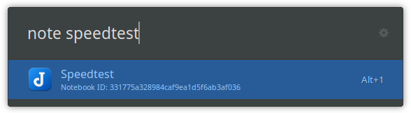
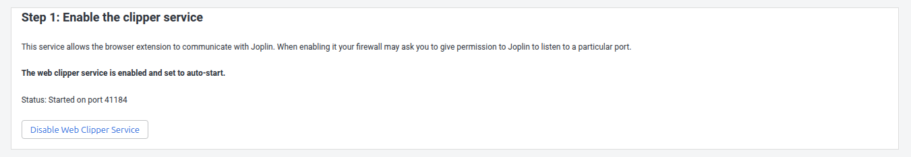
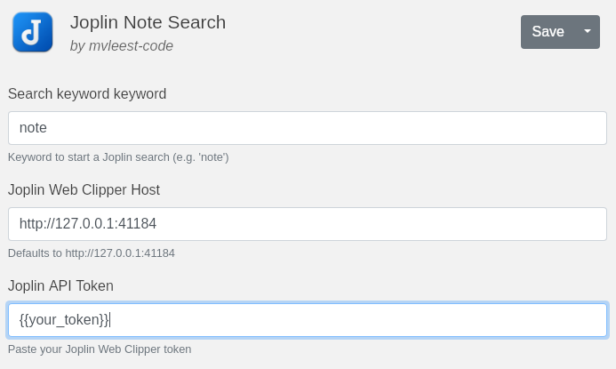
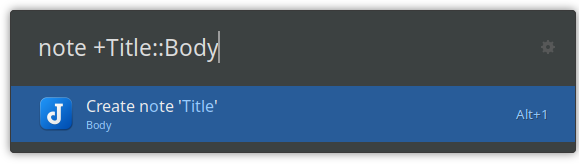

# Joplin Note Search for Ulauncher

[](https://github.com/mvleest-code/UL-JoplinNoteSearch/actions/workflows/tests.yml)
[](LICENSE)

Search, preview and create Joplin notes from the Ulauncher command bar. The
extension integrates with Joplin's existing Web Clipper API; it does not run a
separate note service or store a second copy of your notes.

This is a small personal integration project. It demonstrates API consumption,
configuration, user-facing error handling and support-oriented diagnostics.

## What it does

- Fuzzy-searches Joplin notes and shows short result previews.
- Creates a note using the `+Title::Body` shorthand.
- Opens a note through a Web Clipper command with a `joplin://` fallback.
- Lets users configure the keyword, Web Clipper host and API token.
- Writes rotating diagnostic logs with API tokens masked.



## Integration flow

```text
Ulauncher query
      |
      v
Joplin Note Search extension
      |
      | HTTP request with local API token
      v
Joplin Web Clipper API (default: 127.0.0.1:41184)
      |
      v
Search results, created note or a user-facing error
```

The default connection stays on the local machine. A custom host must be a
complete `http://` or `https://` URL. Do not send a Web Clipper token to a host
you do not control.

## Requirements

- [Ulauncher](https://ulauncher.io/) v5 with extension API v2
- [Joplin](https://joplinapp.org/) desktop running with Web Clipper enabled
- A Joplin Web Clipper token from `Tools -> Options -> Web Clipper`



## Installation

1. Open Ulauncher preferences and select **Extensions**.
2. Select **Add extension**.
3. Paste `https://github.com/mvleest-code/UL-JoplinNoteSearch`.
4. Configure the keyword, host and Joplin token in the extension preferences.



## Usage

- Search: `<keyword> your search terms`
- Create: `<keyword> +Title::Optional body`
- Open: press Enter on a search result



## Troubleshooting

| Symptom | Likely cause | Check |
| --- | --- | --- |
| No results or connection error | Joplin or Web Clipper is not running | Open Joplin and confirm Web Clipper is enabled |
| HTTP 401 or 403 | Missing, expired or incorrect token | Regenerate the token and update preferences |
| Invalid Joplin host | Incomplete URL or query parameters in the host field | Use a complete URL such as `http://127.0.0.1:41184` |
| Note does not open | Web Clipper rejected the command | The extension automatically tries the `joplin://` fallback |
| Keyword does nothing | Preference was not saved | Save the keyword and reopen Ulauncher |

When reporting a problem, include the Ulauncher, Joplin and OS versions. Review
and redact diagnostic logs before sharing them. See [SECURITY.md](SECURITY.md).

## Diagnostics and privacy

`debug.log` is written next to `main.py` and rotates every 30 minutes. Five
backups are kept. Request URLs are sanitized before logging and token query
values are masked. Logs can still contain hostnames, note identifiers, titles
entered while creating notes and error messages. Delete `debug.log*` whenever
you no longer need the diagnostic history.

## Development

```bash
# Link the repository into the local Ulauncher extension directory
mkdir -p ~/.local/share/ulauncher/extensions
ln -s "$(pwd)" ~/.local/share/ulauncher/extensions/com.github.mvleest-code.ul-joplinnotesearch

# Run the dependency-free unit tests
python -m unittest discover -s tests -v

# Start Ulauncher with verbose output
ulauncher -v
```

The unit tests cover URL redaction, host validation and input parsing. GitHub
Actions runs them on Python 3.10, 3.11 and 3.12. Ulauncher/Joplin behaviour still
requires a manual integration check because those desktop applications are not
part of the test environment.

## Known limitations

- Joplin must be running for Web Clipper calls to succeed.
- Search returns at most ten results.
- API calls use a three-second timeout and do not currently retry.
- The extension targets Ulauncher v5/API v2.

## Support and security

Open a GitHub issue for normal bugs and questions. Do not post API tokens, note
contents or unredacted logs. Follow [SECURITY.md](SECURITY.md) for sensitive
reports.

## License

Licensed under the [MIT License](LICENSE).
